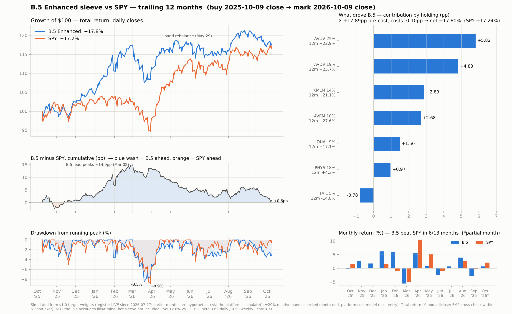

# B.5 Enhanced vs SPY — trailing 12 months

Buy at the **2025-10-09 close**, mark at the **2026-10-09 close** (last complete
session; 2026-10-12 was intraday when this ran). 251 return days.

> **Counter-agent verdict: CONFIRMED-WITH-CORRECTIONS** (2026-10-12). Every
> number reproduced within 1bp from an independent FMP pull and an independent
> band simulator. All five MINOR corrections are applied below. None of them
> changed a headline number. See the log at the end.



## Result (frozen)

| | B.5 Enhanced (v1.0, tail=TAIL) | SPY |
|---|---|---|
| Total return | **+17.80%** | **+17.24%** |
| Excess vs SPY | +0.55pp | — |
| Ann. vol | 12.6% | 13.0% |
| Max drawdown | −8.5% (Mar 2 → Mar 20, 2026) | −8.9% (Jan 27 → Mar 30, 2026) |
| Sharpe (excess of BIL) | 1.07 | 1.01 |
| Beta to SPY | 0.69 daily · 0.58 weekly · 0.55 monthly | 1 |
| Full months beating SPY | 6 / 11 | — |

**Verdict: a statistical tie.** Tracking error is 9.7%/yr, so +0.55pp is an
information ratio of 0.06. The Sharpe gap carries no information either: one
year of data gives a standard error of about 1.2. The sign is not robust (see
Window below).

**Path:** B.5 led by +14.9pp on 2026-03-02 (B.5 +17.5% vs SPY +2.6%). From
Mar 2 to Oct 9: B.5 +0.3% vs SPY +14.3%. Gold round-tripped (PHYS +34.7% at
its Jan 29 peak → +4.3% at the end) and SPY ran +10.5% / +5.3% in Apr / May.

**Drawdowns: same size, different episodes.** B.5's −8.5% (Mar 2–20) was gold
and international (PHYS −16.8%, AVDV −12.3%, AVEM −9.5%) while SPY fell
−5.3%. Over SPY's own drawdown window (Jan 27 → Mar 30), B.5 lost only
−4.6% vs −8.9%.

**Down months: one hedge month, not a pattern.** SPY had 4 full down months.
B.5 fell *more* in 3 of them: Mar −5.6 vs −4.9, Jun −2.3 vs −1.0, Sep −2.7 vs
−0.3. February (+6.0% vs −0.9%) produces all of the 0.69 down-capture;
without it, down-capture is 1.68. Up-capture is 1.07 (7 up months).

**Contribution by holding** (Carino-linked, pre-cost; sums to +17.89pp; costs
−0.10pp → net +17.80%):

| holding | weight | 12m TR | contribution |
|---|---|---|---|
| AVUV | 25% | +22.9% | +5.82pp |
| AVDV | 19% | +25.7% | +4.83pp |
| KMLM | 14% | +21.1% | +2.89pp |
| AVEM | 10% | +27.6% | +2.68pp |
| QUAL | 9% | +17.1% | +1.50pp |
| PHYS | 18% | +4.3% | +0.97pp |
| TAIL | 5% | −14.8% | −0.78pp |

One band rebalance, on 2026-05-29: TAIL had drifted to 3.92% against its 5%
target (−21.6% relative).

## Sensitivities

| variant | B.5 | SPY | excess |
|---|---|---|---|
| **primary** (Yahoo, ±20% bands) | +17.80% | +17.24% | +0.55pp |
| buy-and-hold, same weights | +17.82% | +17.24% | +0.57pp |
| FMP prices instead of Yahoo | +17.79% | +17.24% | +0.55pp |
| tail = NONE (5% pro-rata to the rest) | +19.54% | +17.24% | +2.29pp |
| older thesis-page weights throughout (MTUM 8%, 3% cash via BIL) | +19.65% | +17.24% | +2.41pp |
| thesis-page weights until 2026-07-17, then v1.0 | +18.94% | +17.24% | +1.70pp |
| month-end window (2025-09-30 → 2026-09-30) | +17.56% | +15.70% | +1.86pp |

**Window (the sign is not robust)** (`sensitivity.py`):
- Moving the buy close ±2 weeks gives −2.71 to +0.55pp. 2025-10-09 is the
  most B.5-favourable start in that range. Buying one session later, after
  the 10-10 day when SPY fell −2.7%, gives −0.80pp.
- Moving the mark date over the last 28 sessions gives a trailing-12m
  excess of −0.35 to +7.04pp (median +3.5).

**TAIL:** it cost 1.74pp against no tail sleeve. In return it bought vol 12.6%
vs 13.5%, max DD −8.5% vs −9.0%, and beta 0.69 vs 0.76. One up year can't
price a tail hedge, and the tail choice is still Question #1's placeholder.

## Honesty box

- **Measurement basis:** daily close-to-close MTM, total return (distributions
  reinvested at the ex-date via adjusted closes). Simulated from target weights
  at the start close. This is **not** the live account's holdings, fills or timing.
- **Weights:** the register (`GET /api/versions`, read 2026-10-12) shows
  **v1.0 LIVE, adopted 2026-07-17**. v1.1–v1.4 are unpromoted candidates.
  About 9 of the 12 months predate the adoption, so those months are
  hypothetical v1.0 weights. The older "Current Portfolio (B.5 Enhanced)"
  table on `thesis-deployment.html` / `methodology.html` gives +1.70pp
  spliced or +2.41pp throughout. **Open: which weights were actually held
  before 2026-07-17?** Every variant is still a tie (≤ 0.25 TE).
- **Costs:** the platform's one-way bps model, including the entry trade
  (−0.10pp in total). Not modeled: taxes (Act 60), FX, cash drag, and the bot
  sleeve (B.5 is the 80% sleeve only).
- **Sample:** one year, endpoint-sensitive (see Window). Not a forecast.
- **Data:** Yahoo adjclose is the primary source and FMP dividend-adjusted the
  cross-check. Each ticker's 12m TR agrees within 6.2bp, and no daily return
  differs by more than 50bp (`xcheck.py`). The distribution amounts were
  verified against published sources (log below).

## Counter-agent log (2026-10-12)

The counter-agent wrote its own code, ran it on its own FMP data, and saw
the study only after its recompute.

- **Recompute.** All headline, path, attribution and sensitivity numbers match
  within 1bp, on FMP adjusted closes and on a raw-close + reinvested-
  distribution rebuild.
  - TAIL's 6.2bp vendor gap: the two vendors' 2025-10-09 closes differ by
    half a cent, and FMP rounds adjClose to 2 decimals.
  - KMLM's 4.8bp gap: the two use different dividend-factor conventions.
  - Effect on B.5 in both cases: ≤ 0.7bp.
- **Distributions (common-mode risk; KMLM 2022 precedent):**
  - KMLM Dec-2025 = $1.303457, ordinary income only, no capital-gain
    component. Source: KraneShares' own December 2025 distribution report.
    Yahoo and FMP are complete this year.
  - Avantis Dec-2025 and 2026 amounts, and all TAIL amounts, match
    stockanalysis to 4 decimals (plus digrin / TradingView). The issuers'
    own pages could not be read.
  - Ex-date peer-residual tests: |z| ≤ 1.2. A KMLM-2022-sized miss would
    show as z ≈ +9.
- **MINOR-1 window one-sided → fixed:** added the start/end shift ranges and
  the IR.
- **MINOR-2 capture ratios fragile → fixed:** full months only, n shown, and
  the February dependence stated.
- **MINOR-3 "similar max DD" → fixed:** "same size, different episodes".
- **MINOR-4 LIVE treated as unknown → fixed:** read from the register.
- **MINOR-5 which weights → surfaced as the open question above,** with a
  spliced variant.
- **Notes (no effect on any number):**
  - `engine.py` treats the mark date as a month-end. No band breached on
    10-09 (largest deviation: KMLM at 9.7%).
  - `engine.py:106` charges the rebalance fee as fee/new_wealth instead of
    fee/prev_wealth (~1e-8 here).
  - Fixed in this study: the drawdown base date and the hard-coded band.
  - Daily beta is the highest estimate; weekly and monthly are listed above.

## Reproduce

```bash
pip install -e "barbell-lab[dev]" matplotlib
cd barbell-lab/research/b5_vs_spy_12m
python -I b5_vs_spy_12m.py . results.json        # from the frozen prices.parquet
python -I make_charts.py results.json fig_b5_vs_spy_12m.png
python -I sensitivity.py; python -I xcheck.py; python -I explain.py
# fetch.py <dir> re-downloads into <dir>; point it elsewhere to keep the frozen
# snapshot (vendor adjusted closes re-base after every new distribution).
```

Research only; no service code changed. Merging to main will auto-rebuild
barbell-lab (its build filter covers `barbell-lab/**`). The rebuild is
harmless: research files are not in the image.
