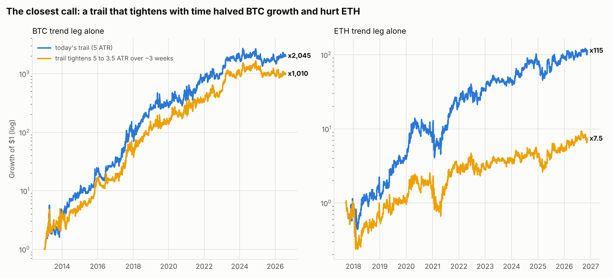

# RESEARCH_EXIT2.md — research-backed adaptive exits for the S4 trend leg (2026-11-16)

Asked by Casey 2026-11-16, about the live short whose 5×ATR trail locks
~$1,700 of ~$4,700 open profit: "there must be a better strategy for
exits … research … backtesting … potentially applying … multiple
strategies that change depending on the conditions … multivariate."
Registration: `research/exit2/PREREG.md` (commit 6935c31d, before any
variant ran). Code, data, results, figures: `research/exit2/`.

## Verdict

**0 of 28 registered adaptive exits made the cut, so no rule was run on
the 12 fresh holdout coins, as registered.** The 5×ATR trail stays. The
holdout is still unused, so it is available for one future registered
candidate.

Two rules passed both BTC tests and failed on the other coins:
- trail tightening 5→3.5 ATR over ~3 weeks;
- wider trail when volatility is high (worse on all 4 coins).

Neither BTC gain is more than luck: the best of the 28 (+0.24 MAR) is about
what the best of 30 random exit rules typically scores (median +0.22; the
95th percentile is +0.59).

## What was tested (from the literature)

| Family | Idea | Source |
|---|---|---|
| V1 | cut size as volatility rises during the trade | Barroso & Santa-Clara 2015; Moreira & Muir 2017 |
| V2 | scale the position with a continuous trend-strength signal, exit when it turns | Baltas & Kosowski |
| V3 | trail width chosen by market regime (volatility, 200-day trend alignment, trend efficiency) | Casey's "strategies that change with conditions" |
| V4 | trail that tightens with time or profit; Parabolic SAR | Wilder; classical |
| V5 | walk-forward logistic model on 11 trade and market features | "multivariate exiting" |

The same literature warns that stop overlays rarely beat the trend rule
itself (Kaminski & Lo; Clare, Seaton, Smith & Thomas). The take-profit
study had already found that for 62 fixed and indicator exits.

## Results

Baseline:
- **BTC live mix, 2022–26:** MAR 1.39 on closed trades, 1.35 marked to
  market.
- **BTC trend leg, 2013–26:** MAR 1.05, ×2,045.
- **Share of the peak kept, on runs that went ≥10% in favor:** median
  **42%** (151 trades). That is the give-back Casey sees on the open trade.

| Best of each family | BTC live mix ΔMAR | BTC trend leg 2013–26 | Other 4 coins | Peak kept | Why it fails |
|---|---|---|---|---|---|
| V4 trail tightens 5→3.5 ATR over ~3 weeks (closest) | +0.18 / +0.19 | +0.04 (×1,010) | 3/4 better, mean −0.02 (ETH −0.59 alone) | 47% | halves BTC growth; it passes B only because max DD fell from −72% to −61%; ETH ×115 → ×7.5 |
| V3 wider trail when volatility is high | +0.23 / +0.26 | +0.25 (×3,065) | 0/4 | 44% | BTC-only: worse on every other coin |
| V1 cut size as volatility rises | +0.04 / +0.06 | −0.05 (×1,066) | 1/4 | 41% | roughly neutral; misses the +10% bar |
| V2 trend-strength scaling | −0.27 to −0.84 | −0.66 to −0.88 | ≤ 1/4 | 15–20% | exits far too early |
| V4 Parabolic SAR | −0.22 / −0.04 | −1.89 | 1/4 | 45–54% | early-era wipeouts |
| V5 multivariate model | −0.44 / −0.47 | −0.27 | 1/4 | 45% | worse everywhere |

Selection needed A (+10% MAR on both bases) and B (not worse) and D (≥3 of
4 coins better, mean > 0). Of the 28:
- 3 passed A;
- 8 passed B;
- none passed D. Two rules improved 3 of 4 coins but lost on average.

Full rows: `research/exit2/results_sel.json`.

## Why the give-back is hard to remove

Some exits do keep more of each run. Six rules kept 44–47% of the peak and
grew BTC more over 2013–26 (×2,975–×6,619 vs ×2,045): four regime-based
trails and two slow time-tightening trails. But all six failed on the other
coins, and five of the six also missed the live-mix bar. No rule kept more
on BTC and held up on the other coins.

On BTC, keeping more and growing more go together:
- rank correlation +0.25 across all 28 rules;
- +0.80 without the two Parabolic SAR rules, whose books went below zero.

Still, 12 of the 18 rules that kept more than 42% grew BTC less than
today's trail, and none held up elsewhere. So the give-back is not itself
the cost. Every way we found to reduce it was BTC-specific.

The "kept" median also cannot see the right tail, which is where the money
is: today's top 10% of trades earn 3.6× the leg's net P&L.

## Honesty box

- **In-sample** for selection:
  - BTC to 2026-07;
  - ETH, LTC, XRP, BCH, which were already the take-profit study's
    out-of-sample set.

  The 12-coin holdout (SOL, LINK, ADA, XLM, DOGE, AVAX, DOT, UNI, AAVE,
  ALGO, NEAR, SHIB) was not used: no finalist existed.
- **Basis:** 6 bps/side on entry notional at every close, partials pro rata;
  no slippage or funding. MAR on closed-trade and marked bases. Criterion A
  runs the deployed 50% trend-leg kill switch; B and D run with it off.
- **Not tested:**
  - adding back to a position (all scaling is down-only);
  - combining families;
  - tree or other non-linear models;
  - exits for the pullback leg;
  - portfolio-level interactions beyond the deployed blend.
- **V5:** the model for each year was trained only on in-sample trades that
  closed before that year began; λ, features and thresholds were fixed in
  advance, not tuned.
- **"Peak kept"** is the median share of the best favorable price move
  realized, on trades whose peak move was ≥10% of entry; it includes the
  exit bar's extreme.
- **Kill switch and partials:** 11 of the 28 rules trip the trend leg's 50%
  kill switch inside the 2022–26 window, so their A numbers partly measure
  the halt. The closed-trade basis counts each partial exit as an event,
  which penalises V1 and V2. Every row fails D, so neither changes the
  verdict.
- **No liquidation model:** the trend leg runs at a fixed 1× with no
  liquidation. Both Parabolic SAR books go below zero after an April-2013
  short, so their B and D figures are meaningless. Both fail A anyway.
- **Design notes:**
  - trend-strength scaling churns 642–805 entries vs 340;
  - the model's θ = 0.6 sits at the label's base rate (0.59–0.63);
  - for each alt's first year, the vol regime is 1.0 and alignment reads
    "against";
  - regime trails can never loosen the ratcheting stop.
- **Holdout contact:** only BASE (gate G1), plus never-firing settings on
  SOL (gate G6), pass/fail identity only.
- **Trials:** 28, registry ~2,636. §7 overridden by the owner (§9a).

## Counter-agent log

- **C, one independent verifier** (null result, no live change, so one
  verifier per the cost rule). Verdict: 0 of 28 selected, holdout untouched,
  confirmed.
  - Its own engine-path recompute (patched `_process_donchian`, its own
    blends and MAR) reproduced all 26 non-model rows to 4e-12.
  - It audited V5: the label was recomputed, training uses only trades
    closed before each year, no leakage was found, and the model does fire.
  - Every A/B/D flag was recomputed: 0 mismatches. D fails on all 28.
  - Defects, all fixed or disclosed:
    - SERIOUS: the draft line "keeping more made less money" was
      backwards. Corrected above, with its numbers.
    - MINOR: the second BTC passer, the luck bar, and the near-miss's
      D-only-on-the-mean failure had been left out. Added.
    - MINOR: the gates missed four planted rule-logic bugs (long-side sign,
      vol floor, scale step, model training cutoff). Four tests added, each
      killing its mutant; gates are now 76/76.
    - MINOR: chart captions. Fixed.
    - NOTEs: disclosed in the honesty box.

## What to do

Nothing changes on the live executors; nothing to redeploy. On the open
short, the trail will lock in more as BTC makes new lows, and gives back up
to ~5 ATR if it reverses.
