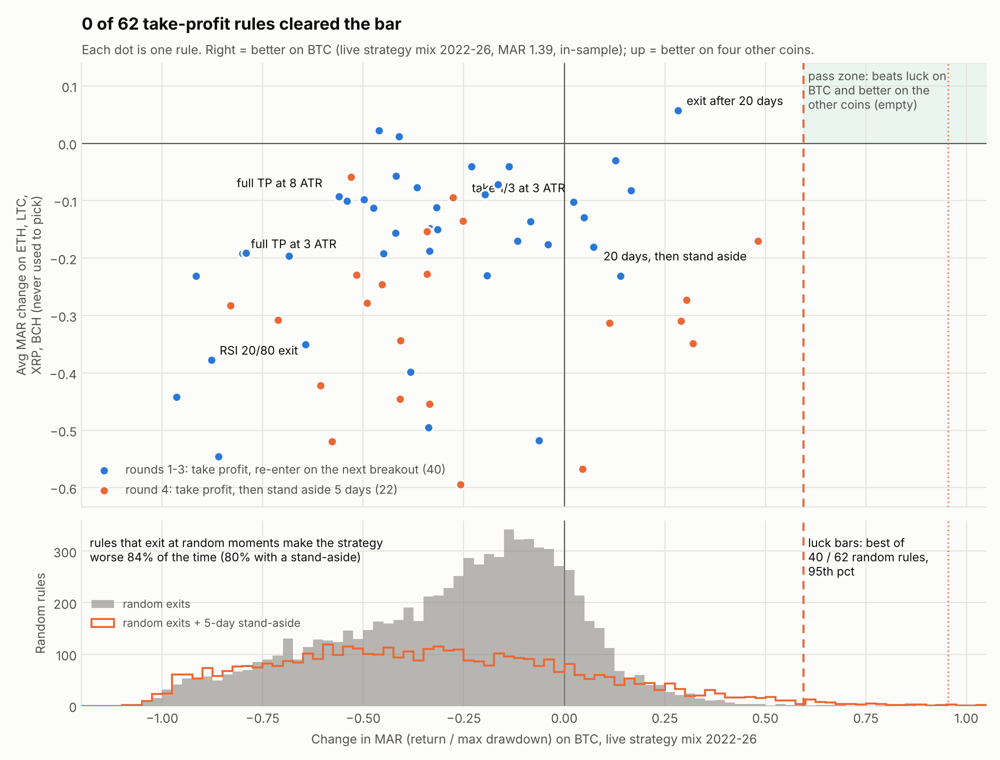
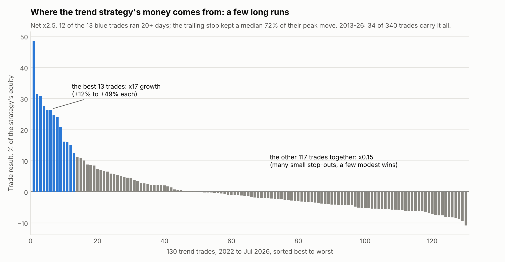
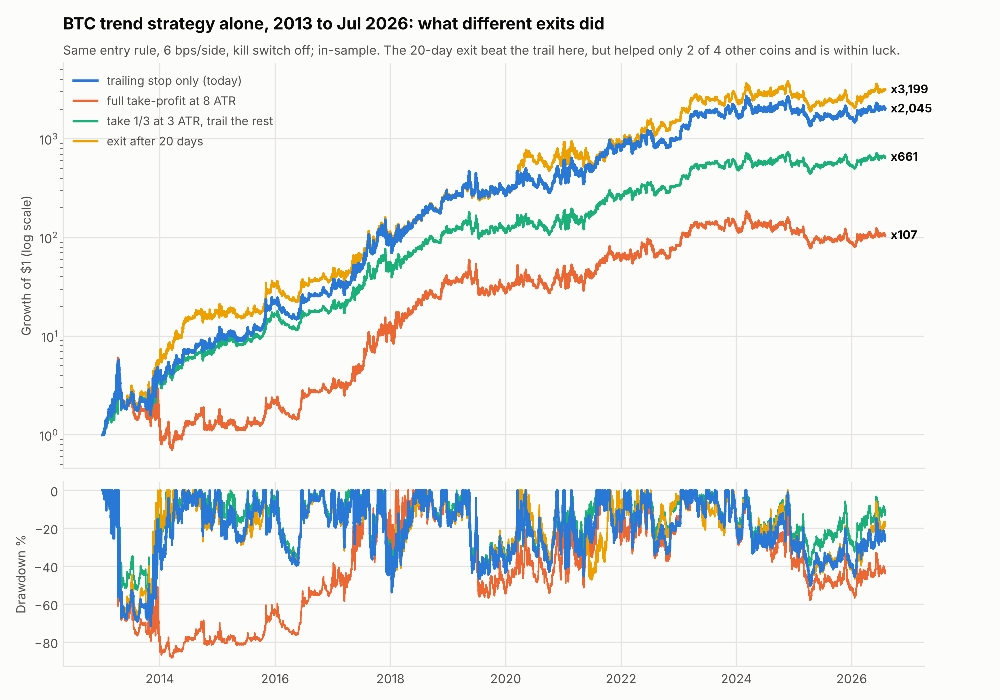

# RESEARCH_TP.md — when should the S4 trend leg take profit? (2026-11-14)

Asked by Casey 2026-11-14: "how are we gonna ever make money if we're not
taking profits … at some point there needs to be an intelligible time which
you take profit." Registered study: `research/tp/PREREG.md` (rounds 1–3) plus
AMENDMENT 1 (round 4), each committed before it ran. Code, data, results and
figures: `research/tp/`.

## Verdict

**0 of 62 registered exit rules cleared the bar.** None beat the 5×ATR
trailing stop on BTC by more than luck *and* held up on ETH, LTC, XRP and
BCH. The registered answer is: **keep the trailing stop. It is the
profit-taking mechanism.** That is a statement about these 62 alternatives,
not a claim that 5×ATR is optimal: it was tuned on BTC and its holdout is
spent (§9a).

## Results

Baseline (MAR = CAGR ÷ max drawdown):
- **Live strategy mix on BTC, 2022-01 to 2026-07** (30% trend at 1.5×, both
  legs as deployed): MAR 1.39 (CAGR 32%, max DD −23%) on closed trades; 1.35
  marked to market.
- **Trend leg alone on BTC, 2013 to 2026-07** (kill switch off): MAR 1.05
  (CAGR 75%, DD −72%, ×2,045).
- **Trend leg alone on the other coins:** MAR 0.90 (ETH), 0.05 (LTC),
  0.04 (XRP), 0.49 (BCH).

| Exit rule | BTC live mix 2022–26, ΔMAR (closed / marked) | BTC trend leg 2013–26, ΔMAR (end value) | Other coins better | Beats this share of the best-of-N random rules (needs 95%) | Fails |
|---|---|---|---|---|---|
| Exit after 20 days | +0.28 / +0.27 | +0.16 (×3,199) | 2/4 (ETH flat) | 66% (N=30) | C, D |
| Exit after 20 days, stand aside 5 (R4) | +0.48 / +0.47 | +0.00 (×1,447) | 2/4 (mean −0.17) | 44% (N=62) | C, D |
| Trend-efficiency fade, stand aside (R4) | +0.32 / +0.51 | −0.54 (×82) | 1/4 | 18% (N=62) | B, C, D |
| After 8 ATR profit, tighten trail to 3.5 | +0.05 / +0.10 | −0.07 (×1,179) | 1/4 | 4% | A–D |
| Take ⅓ at 3 ATR, trail the rest | +0.02 / +0.06 | −0.07 (×661) | 0/4 | 2% | A–D |
| Full take-profit at 16 ATR | −0.16 / −0.15 | −0.20 (×838) | 1/4 | — | A–D |
| Full take-profit at 8 ATR | −0.50 / −0.40 | −0.59 (×107) | 0/4 | — | A–D |
| Full take-profit at 3 ATR | −0.80 / −0.74 | −1.62 (wiped out) | 0/4 | — | A–D |
| Breakeven stop after 4 ATR | −0.41 / −0.35 | −0.23 (×605) | 3/4 (mean +0.01, noise) | — | A, B, C |
| Exit on 20-bar opposite channel | −0.47 / −0.36 | −0.28 (×453) | 1/4 | — | A–D |
| Exit on RSI 20/80 | −0.88 / −0.79 | −0.94 (×3) | 0/4 | — | A–D |
| Exit after a 2.5-ATR climax bar | −0.33 / −0.35 | −0.26 (×352) | 0/4 | — | A–D |

Criteria (PREREG §6): **A** live mix +10% MAR on both bases · **B** trend leg
2013–26 not worse · **C** beats the 95th percentile of the best of N random
exit rules · **D** better on ≥3 of 4 coins with a positive mean. Of the 62
rules, A passed 7, B passed 4, C passed none and D passed 1 (breakeven after
4 ATR, by noise). Full rows: `results_r1..r4.json`.

## Why the trailing stop wins here

- **The money is in a few long runs.** 2022–26: 13 of 130 trend trades took
  the leg ×17; the other 117 together ×0.15; net ×2.5. Twelve of the 13 ran
  20+ days (median 30), and the trailing stop kept a median 72% of their peak
  move. 2013–26: 34 of 340 trades, 25 ran 20+ days, 65% of the peak kept.
- **Early exits look like random exits.** Rules that exit at random moments
  make the strategy worse 84% of the time (80% with a stand-aside), and most
  take-profit rules land in that same range. Counter-agent B's
  frequency-matched check found exits that fire on strength (RSI, climax,
  overextension, full TP at 8–12 ATR) did *worse* than random exits of the
  same frequency.
- **A take-profit in a breakout system mostly sells and buys back.** About
  90% of full take-profits re-entered on the same side within one bar
  (counter-agent B's count): the TP
  fires on a fresh 20-bar extreme, so the breakout signal re-arms. Round 4
  removed that with a 5-day stand-aside, and it still failed out of sample.

## So when does this strategy take profit?

At the trailing stop. Every 4h close it moves the stop to close ± 5×ATR,
only ever in the trade's favour. Once the stop passes the entry, a stop-out
*is* a profit taken. On the open short (2026-11-14) it has locked about
+$790 of a ~+$3,900 open profit. The cost is the give-back, up to 5 ATR from
the best close. That give-back buys the long runs that make all the money.

**The one pattern worth watching:** exit after 20 days, then stand aside 5.
On BTC it improved the live mix in every year 2022–26 (marked to market
+86/+93/−2/+25/+23% vs +44/+88/−3/+22/+16%). But:
- it was flat on BTC 2013–26;
- it helped only 2 of the 4 other coins;
- it scores no better than the best of 62 random rules (44th percentile).

Under §9a and AMENDMENT 1 it can only become a candidate on fresh data.

## Honesty box

- **Basis:** the research basis, 6 bps/side on entry notional at every close
  (partials pro rata), which is the registered objective. TP limits would
  fill as maker; worth ≈0.07 log on full-TP-8 against a 2.95 gap, so
  immaterial. Not modeled: slippage, funding, a liquidation floor. Three
  configs' trend-alone books went below zero on an April-2013 short and fail
  B either way.
- **In-sample:** every BTC bar to 2026-07 is in-sample. The incumbent trail
  was tuned on it (home-field advantage), so the cross-asset test D is the
  only clean one. Forward window 2026-09 to 11: 7 trades, mixed; not cited.
- **MAR measured both ways** (closed-trade bench arithmetic with the start
  point kept, and marked to market). MAR can hide lost growth: take ⅓ at 3
  ATR ends ×661 vs ×2,045 at a similar MAR, because it also cut the drawdown.
- **Kill switch:** criterion A runs the deployed 50% trend-leg halt. 16 of the
  40 round 1–3 rules (and ~30% of random rules) tripped it in 2022–26, mostly
  March–April 2025, so their A numbers partly measure the halt; with it off,
  no A verdict changes (counter-agent B). The baseline itself reached −45.4%
  closed / −50.3% marked in that window, within 4.6 points of its own switch.
- **Conventions not written in PREREG §7** (found by counter-agent A;
  sensitivity measured; no pass/fail changes):
  - close-based exits are never judged on the fill bar's close (the engine
    does the same);
  - the profit lock tightens one bar after it triggers;
  - the best close used for lock, breakeven and ER excludes the fill bar.
- **Not tested:** stand-asides other than 5 days, re-entry rules other than
  the engine's breakout, size scaling, regime filters.
- **DSR** (protocol §2 basis, N = 2,608): live mix 0.16, best rule 0.42.
  Neither is distinguishable from selection bias. With the hurdle taken from
  this study's own 62-trial spread they read 0.82 / 0.96, but those are
  correlated variants and not comparable to §2.
- **Process:**
  - §7 was overridden by the owner;
  - round 4 is post-hoc (AMENDMENT 1, registered before it ran);
  - 62 trials, registry ~2,608;
  - run.py was committed 1m53s after PREREG, before any result.

## Counter-agent log

- **A, code and data (round 1–3 pass):** the harness is clean.
  - An independent rebuild (engine `run_replay` with patched exits, the
    bench blend, and its own simulator) reproduced all 40 judge rows exactly.
  - Data hashes and commit order confirmed.
  - Defects, all MINOR/NOTE, none verdict-changing:
    - a vacuous G4 cut;
    - gates blind to fire-logic errors (two planted mutants passed): fixed
      with `test_fire_logic.py` (G8), which kills both;
    - the undeclared conventions above;
    - no negative-equity floor;
    - A-by-year and DSR not computed: added in `report.py`;
    - chart captions: fixed.
- **B, statistics:** 0/40 confirmed by recomputation; the null reproduced
  exactly.
  - The headline overstated ("no rule beat the trail out of sample"):
    reworded.
  - The incumbent's home-field advantage: disclosed.
  - The re-entry design: became round 4.
  - The partial TP's higher win rate (2013–26: 45% → 53%) must carry its
    costs: it does, in the table.
- **A, round 4 pass:** PENDING.

## What to do

Nothing on the live executors, and nothing to redeploy. Optional, Casey's
call: shadow-track "exit after 20 days + 5-day stand-aside" as a paper book
in btc-paper-engine (research only, its own gates). That collects the fresh
data any adoption would need: 15 trades, about 6 months at this leg's pace.
