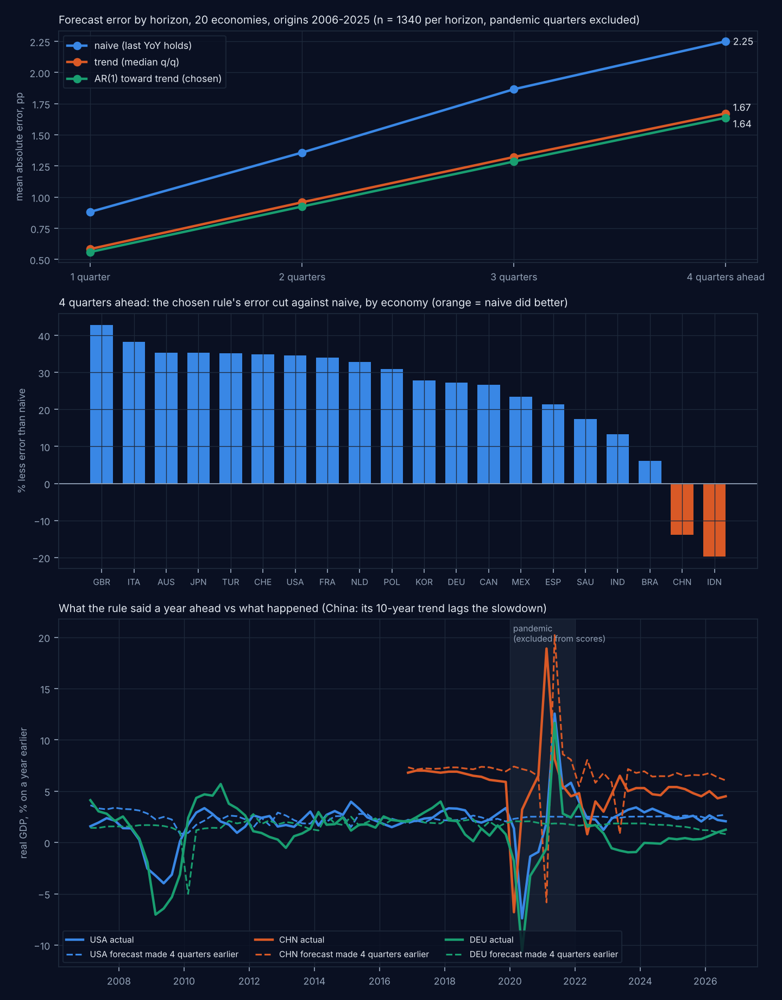

# GDP watch — growth of the largest economies, with a tested 4-quarter projection

Casey, 2026-11-16: "a chart that shows the gdp growth, and gdp growth by capita (toggle between) of the top 25
countries (or whichever number makes sense) ... make each country toggle on and off ... try to work an average or
mathematical basis to try to predict what the chart for each country will look like over the next year ... custom
dates ... past 1, 3, 5, 10, 25 years."

Shipped as the **GDP** tab on treasury-canary (`GET /gdp-watch`). Study code and frozen outputs are in
`studies/gdp_watch/`.

## 1. Results first

| Method, mean absolute error in points of YoY growth (pandemic quarters out) | 1q | 2q | 3q | 4q | 4q, pandemic in |
|---|---|---|---|---|---|
| Naive (last YoY holds) | 0.88 | 1.36 | 1.87 | 2.25 | 2.98 |
| Trend (10-yr median q/q) | 0.58 | 0.96 | 1.32 | 1.67 | 2.16 |
| **AR(1) toward trend (chosen, shown on the tab)** | **0.56** | **0.93** | **1.29** | **1.64** | 2.24 |

- **Sample:** 20 economies, origins 2006-Q1 to 2025-Q3: 1,340 projections per horizon with the pandemic quarters out, 1,500 with them in. The pool is not uniform: China's origins start in 2015-Q4 (32 at 4q), Saudi Arabia's in 2015-Q1 (35).
- **Against naive, four quarters ahead:** the rule does better in 18 of 20 economies, a median of 29% less error across all 20 (from +43% UK to +6% Brazil among the 18). That 18 is a point count: in 14 of the 20, the block-bootstrap 95% interval clears zero.
- **Naive did better** in China (−14%) and Indonesia (−20%). Neither interval excludes zero. Both official series are very smooth.
- **Against trend-only, it is noise.** AR(1) is 2.9% better with the pandemic out (95% interval −1% to +8%). Trend had the lower error in 12 of 20 economies. With the pandemic in, trend wins at every horizon (2.16 vs 2.24 at 4q), and the selection rule would have picked it by 3.0%. Today the two lines differ by at most 0.4 points.
- **Bands, tested out of sample.** Fitted on origins up to 2015-Q4 and tested on 2016 onward, on 18 economies:

  | Band | Pandemic out (n = 553) | Pandemic in (n = 697) |
  |---|---|---|
  | 80% | held 85–88% | held 73–76% |
  | 50% | held 59–60% | held 49–51% |

  - By economy at 4q, the 80% band held from 58% (France) to 100% (Germany).
  - China and Saudi Arabia have too little history before 2016, so their bands are in-sample only.
  - The bands drawn on the tab use every miss since 2006, so they are in-sample too.
- **China's line sits above its own band.** The rule over-projected China in 31 of 32 backtests (median miss −1.19). The tab flags this in the legend, the table and the takeaways. No correction was applied (§2).
- **The rule lags slowdowns.** Since 2023 its 4q projections ran too high in most economies. Mean miss, n = 14–15 per economy:

  | Germany | Poland | China | Turkey | Netherlands |
  |---|---|---|---|---|
  | −1.46 | −1.39 | −1.15 | −1.05 | −1.04 |
- **A 5-year trend window** was tested (minimum AR pairs scaled 12 → 6, common origins 2016-Q4 on). It does better in 7 of 20 economies (Brazil, Switzerland, China, Germany, UK, Korea, Turkey); China's error falls from 1.74 to 1.10. It is worse pooled at 4q (1.386 vs 1.285), mostly from India (+1.23) and Mexico (+0.41). The frozen 10-year rule stands. This is disclosed, not switched.

The chart shows error by horizon, skill against naive by economy, and what the rule said a year ahead against what happened (US, China, Germany).

## 2. Edge checks: both null

All checks are point in time, at 4q, with the pandemic out (`studies/gdp_watch/edge_checks_v1.py`).

| Candidate | n | Result | Mirror / placebo |
|---|---|---|---|
| Shift each line by its own past median miss (8 or more past misses whose target had printed) | 1,120 | **+12.0% error (worse)**; worse at every horizon (+4.0% at 1q to +12.0% at 4q) | Sign flipped: +9.5%. Another economy's miss: +10.0% |
| Same shift, China only | 21 | −31% (better) | Picked because China looked biased. It helped in only 2 of 20 economies (China, and Australia at −1.6%) |
| Gap between the 5-year and 10-year trend predicts the miss | 1,340 | r = −0.01 | — |

- **To use the China shift,** it would have to be pre-registered and scored on quarters not yet published. It is not adopted.
- **No market edge:** no asset return was tested.

## 3. Data

| Choice | Why |
|---|---|
| **20 economies, 79% of world GDP** (IMF 2025, market FX) | The largest with current quarterly data. The US and China alone are 43% and the six largest 57%, so a few economies set the pace. Those six are selected by default. |
| Russia out | Its OECD quarterly series stops in 2021-Q3. |
| Taiwan out | Not in the OECD accounts. |
| G20 and OECD aggregates | Shown, never projected (not in the study). |
| **Quarterly, % on a year earlier** | OECD QNA (`DF_QNA_EXPENDITURE_GROWTH_OECD`, seasonally adjusted). It makes the 1Y and 3Y views meaningful; annual data would give 1–3 points. |
| **Per person** | GDP growth divided by population growth over the same four quarters, from IMF WEO population (log-linear between mid-years, IMF projections ahead). Saudi Arabia's population series swings from −2.5% to +5.0% a year in 2018–22, and Poland's drops 2.3% in 2021 (a level break). Per-person moves there come from population, not output; the tab notes both in per-person mode. |
| IMF WEO projections | Shown beside the rule as an independent reference. The years shown follow the projection window, never the clock. India's are fiscal years (April–March: 2026 = FY2026/27), and the tab labels them. Not backtested here: DataMapper serves only the current vintage. The WEO historical databases would allow a backtest (§7). |

- **Snapshot:** frozen at `data/snapshot_2026-11-16.json.gz` (44 KB). The tab's cold-start fallback is a byte-identical copy, labelled as such on the tab.
- **Partial live replies:** if an economy is missing from a live reply, it keeps its snapshot copy, and the status reads "partly snapshot".
- **Roll-forward identity:** rolling the published YoY forward with the published q/q reproduces the next YoY exactly for 19 economies. China is 0.135pp off, because its official YoY is not seasonally adjusted while its q/q is.

## 4. Method (frozen; selection rule written before the run)

- **Target:** YoY real GDP growth, 1–4 quarters ahead, using data dated up to the origin only.
- **Candidates.** None was tuned on outcomes:
  - naive;
  - trend: each coming quarter grows at μ, the median q/q of the 40 quarters to the origin;
  - AR(1): q/q decays toward μ at rate φ. φ is the least-squares slope through the origin (no intercept) of the deviations from μ, over the same 40 quarters, clipped to [0, 0.8].
- **Pandemic quarters** (2020-Q1 to 2021-Q4) never enter μ or φ.
- **Forecast path:** trend and AR(1) roll the published YoY forward one quarter at a time, so the quarters already published count.
- **Selection rule:** lowest mean MAE over h = 1–4, pandemic out. A method within 2% of a simpler one loses to it.
- **Outcome:** AR(1) won by 2.9% over trend. That is inside the noise (§1).
- **Parity:** the tab's code equals the study's at every origin (a merge-blocking gate).

## 5. Honesty box

- **Revised data.** The record uses today's revised data, not real-time vintages. First releases get revised, so real-time misses run larger than shown.
- **Pandemic.** It is left out of the scores and the bands, and a shock like it falls outside them.
- **In-sample choice.** The method was picked from three on the same data. Its edge over trend is noise, and it reverses with the pandemic in. Its edge over naive is not noise (14 of 20 intervals clear zero).
- **In-sample bands.** The bands drawn use all misses since 2006. The split test measures how far to trust them. China's and Saudi Arabia's were not tested.
- **Per person.** The line is the GDP projection less IMF population growth, and its band is the GDP band moved with it. It was not backtested on its own.
- **No market edge.** Neither edge check in §2 surfaced one, and no asset return, conditional trade or mispricing was examined. The rule's over-projection since 2023 is a statement about the rule, not a tested market signal.

## 6. Counter-agent verdicts

**Statistics review (2026-11-16): PASS_WITH_FIXES.**
- **What held up:** it reproduced every headline number from the snapshot, found no look-ahead, and the data matched fresh pulls.
- **SERIOUS:** China's line sat above its own band with no explanation. It is now flagged on the tab. A bias correction was tested and rejected (§2).
- **MINOR, all fixed:**
  - the median was 29%, not 31%;
  - China and Turkey are −1.1 (n = 14–15);
  - the pandemic-in rule picks trend;
  - the AR(1)-vs-trend edge is fragile;
  - the window sensitivity had a minimum-pairs confound;
  - band coverage needed disclosure;
  - India's IMF figures are fiscal years;
  - WEO historical vintages do exist.
- **Its bias-correction check** gave +18% (n = 1,120). This memo's point-in-time version gives +12.0% on the same n. Both say worse.

**Build and wording review (2026-11-16): PASS_WITH_FIXES.**
- **SERIOUS:** the IMF years were read from the wall clock, so a gate would have gone red on 1 January. They now come from the data's projection window, with a gate.
- **MINOR, all fixed:**
  - per-person columns are labelled by measure;
  - the snapshot fallback is labelled;
  - the smoke test counts drawn marks and checks fixture values, slots and the cap;
  - the hover tooltip notes when a line sits outside its band;
  - the honesty box carries the in-sample lines;
  - the legend reads "rule:" and appears only with the projection on screen;
  - every line is labelled at its end, with `aria-pressed` and a chart label;
  - year labels thin out on a phone;
  - per-person mode handles aggregates;
  - the range text, the custom defaults and open-ended dates are fixed;
  - the dev proxy covers `/gdp-watch`.
- **NOTE, fixed:**
  - an unparseable reply falls back;
  - a missing economy keeps its snapshot copy;
  - a forced warm-up waits for a running build;
  - the memo numbers are corrected;
  - the tab bar scrolls on a phone;
  - dead code is removed.

**Re-verification of both SERIOUS fixes:** pending, by two independent verifiers.

## 7. Open questions (ranked)

| P | Question | What it would move | Status |
|---|---|---|---|
| P2 | Backtest the IMF's projections using the WEO historical databases (past vintages)? | Whether the IMF shares the rule's China over-projection, and whether it earns more than "reference" on the tab | open, first asked 2026-11-16 |
| P2 | Measure the real-time error with first-release vintages (OECD or ALFRED revisions)? | The width of the bands | open, first asked 2026-11-16 |
| P2 | Add the euro area as one economy? | One line for the EUR bloc instead of six members | open, first asked 2026-11-16 |
| P3 | Anchor the trend to the IMF's medium-term growth instead of the 10-year median? | The 2023+ over-projection. Testable with the WEO vintages above. | open, first asked 2026-11-16 |

Redeploy: **treasury-canary** (autodeploy on merge to main).
