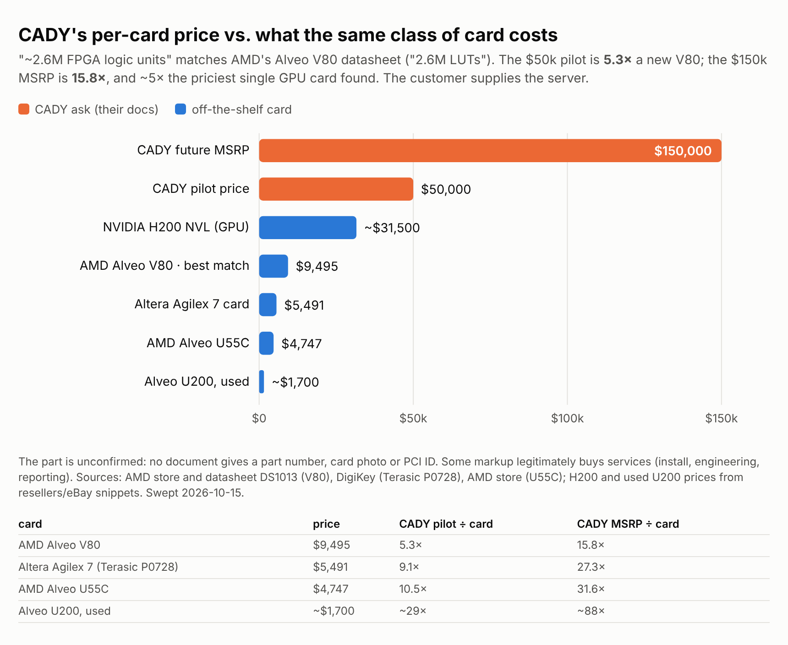

# CADY "Compute Accelerator" — International Clearinghouse / Intelavation / WeSave

**Light-touch intake, 2026-10-15 (rev 1, pre-DD).** Casey's scope: "high-level
sussing out, don't take this one too seriously." So: 3 evidence sweeps + 1
adversarial counter-agent + an independent reproduction. **No 5-scorer panel, no
red team, no EV tree, no ledger row, no dashboard card** — say the word and it
gets the full S1 treatment.

Tags: [VERIFIED] primary source · [SECONDARY] third-party · [CLAIMED] their docs
only · [CONFLICT] · [NOT FOUND] searched, absent · [REFUTED] · [ANALYST].
Sweep files with every source URL: `sweeps/`. **Counter-agent verdict: APPROVED
WITH CORRECTIONS — all applied below** (`sweeps/counter.md`; it re-checked every
load-bearing item against primary sources and softened four of them).

## Documents

| document | read | notes |
|---|---|---|
| CADY Accelerator Overview "Oct 1st 2026" (2 pp) | **YES** | The PDF file was rendered by ChatGPT on 2026-10-06; its OpenAI-signed C2PA credential validates (see §1) |
| "The Thinking Chip", June 2026 (8 pp, CTO John Wilson; file author RJ Stewart) | **YES** | p.5 is blank in the PDF as supplied |
| "Hierarchical Reasoning & Graded Recognition" milestone, "Proven June 30, 2026" | **YES** | File created 2026-07-01, **re-edited 2026-10-15** (filename "UPDATED") |
| Pilot flyer (2 pages, one image sent 4×) | **YES** | Same content as the Overview |
| The milestone's "verifiable technical appendix" | **NOT SUPPLIED** | Promised in the milestone; P1 ask |
| **The ask** (what Casey is being offered) | **NOT SUPPLIED** | Pilot purchase? equity? reseller slot? — unknown, so price is unscored |

Source files: `source/` (PDFs, extracted text, flyer).

---

## 0 · THE READ

**A family-run loyalty-rewards group relabelling itself as an AI-chip company,
selling what looks like a stock AMD/Altera FPGA card at 5–30× its price, with a
"proven" reasoning demo that is textbook 1970s AI and that offers no evidence it
ran on the chip at all** (by the sheet's own account the FPGA core was "untouched"
and the capability came from a saved knowledge graph). No evidence of fraud was found; no evidence of anything
proprietary either. Casey's prior ("nothing they have is proprietary") is
supported, not proven: the one place IP could hide (unseen FPGA design files) has
not been shown, and a one-hour demo would settle it (§6, P1 #1).

---

## 1 · WHO THEY ARE

| finding | tag |
|---|---|
| **ICH = International Clearinghouse, Inc.** — Nevada corp (2019), Newhall CA, a **loyalty-rewards processor**. Its website has no CADY or FPGA content; the CADY "apply" link `/team-3-1` is a loyalty "Strategic Partners" page with a generic contact form. ICH's own homepage calls it "cloud-based" (vs. CADY's "No Cloud"). | VERIFIED |
| **Ownership:** Source Clearinghouse 68% / WeSave 20% / MetaBank 12% (stated in WeSave's SEC offering circular). Stewart family controls Source and WeSave. | CLAIMED (in an SEC filing) |
| **The tech sits elsewhere: Intelavation LLC** — Oregon LLC formed **2025-05-22**, office a Phoenix apartment, registered agent **John D Wilson**, Eugene OR; 5 members, names behind a captcha. Link to "CTO John Wilson" rests on the milestone header only. **No public FPGA/hardware/AI work by him found** (no papers, patents, code, talks). | VERIFIED (entity) / SECONDARY (identity link) |
| **IP ownership conflicts:** Thinker says "All IP… owned by ICH"; milestone brands the work "Intelavation LLC and WeSave". No assignment on record. **No patents** (any entity/person, FPGA/cognitive), **no trademark** for CADY or slogans; "CADI" (milestone spelling) is a pending stylized mark in Class 42 AI-as-a-service by an unrelated Cadi.me LLC (SN 99577584, suspended 2026-09-01; confirmed on USPTO). Post-Apr-2025 patent filings and provisionals would be invisible. | VERIFIED / NOT FOUND |
| **25 years of private raises for one loyalty concept:** Source Form Ds 2001/2006/2014 ($4.6M, 82 investors)/2015–19 ($3.05M of a $50M 506(c)); Help International S-1 (2015–16, never effective); **WeSave Reg A Tier 2, $74.25M, qualified 2024-07-08 — FY2023 revenue $939**; no 1-K or 1-SA filed since — **delinquent**: Rule 257(b) ties reporting to qualification, not to sales, and a 1-Z exit is barred until the FY2024 1-K is filed. A Reg CF closing report (C-U) also appears to have been required and is absent. 2023: SEC staff told WeSave its first structure was security-based swaps → withdraw. | VERIFIED |
| ICH and WeSave show **"Default"** status in Nevada — an administrative lapse in filing the annual list/fees (NRS 78.170), curable for ~$75, leading to revocation after ~12 months; dates from after 2026-03 (ICH) and 2025-10 (WeSave). OpenCorporates copy; the state registry was unreachable. | SECONDARY |
| **In their favour:** people are real and connected. **Brad Hanson** = ex-CEO of MetaBank; MoneyLion's 10-K lists him on the Source/Help/WeSave/ICH boards. RJ Stewart = Richard Jr.'s son. **No SEC enforcement, FINRA or federal-court record** against any principal or entity. WeSave did get through SEC review with counsel + auditor. | VERIFIED |
| **Titles conflict:** CEO = Richard G. Stewart Jr. (Thinker Jun, Overview Oct) vs **Brad Hanson** (milestone, edited today; also ICH's own leadership page). Hanson has been **CEO of Maxwell State Bank since July 2025** — a ~$32M-asset, one-office bank, so a dual role is plausible; his CADY role is **unconfirmed**. Flag: a sitting bank CEO fronting a product sold to banks. | CONFLICT |
| **Stewart credentials:** claimed Ph.D. (U. Miami "Spectrum Center", "ISBN 00095" — not a valid ISBN) is **unverified** and absent from his 2016 S-1 bio; real-estate capital raised "over $150M" (2016 S-1) vs "$300M" (sites today) — drift, not a strict contradiction. | NOT FOUND |
| **Pattern:** since 2019 ICH has marketed a defense partner's "virtually unhackable" radio network ("Spectrum") as its own future — same rhetoric as "no remote exploit for a wire". | VERIFIED (page) |
| **Docs:** the "Oct 1st" Overview **PDF file was rendered by ChatGPT** (`claim_generator_info` "ChatGPT", agent `gpt-5-5-instant`, 2026-10-06T17:27:54Z). The counter-agent validated the OpenAI-signed C2PA manifest cryptographically: the file is byte-identical to what ChatGPT emitted. It proves who produced the file, not who drafted the words. Three pitches in four months: bank anomaly-watcher (Jun) → symbolic reasoner (Jun 30) → data-center AI-inference card (Oct). | VERIFIED |

## 2 · THE PRODUCT CLAIMS

| claim | verdict | why |
|---|---|---|
| "~2.6 million FPGA logic units" | **COTS-consistent** | AMD Alveo V80 datasheet: "2.6M LUTs" (2,574,208). Also fits VU9P cards (U200/AWS F1, 2.586M "system logic cells") and Altera Agilex 7 AGF027 (2.69M LEs). No part number, photo or PCI ID anywhere. |
| $50k pilot / $150k MSRP per card | **5–30× the card** | V80 $9,495 new; Agilex card $5,491; U55C $4,747; used U200 ~$1.7k. Priciest single accelerator card found: H200 NVL ~$31.5k. Customer supplies the server. |
| "American Silicon" | **REFUTED for AMD parts** | Versal/UltraScale+ are TSMC Taiwan; only an Intel/Altera part could fit. |
| "To change how she thinks, you would need physical access to the chip" | **REFUTED** | On every candidate card the FPGA logic is (re)loaded by host software over PCIe — changing it needs privileged access to the host server, not the chip. The V80 also runs Arm cores + firmware. |
| "No program to exploit… no remote exploit for a wire" | **UNSUPPORTED** | Reduces to the host's own network attack surface plus any network-facing logic on the card's ports; not disproven. (AMD's 2025 Alveo CVEs are local host-driver bugs in XRT, which the V80 doesn't use.) Whether CADY disables host reprogramming: ask. |
| "About 20 watts" | **CONFLICT** | Candidate cards rated 115–225 W; ~20 W ≈ idle — incompatible with "ultra-high inference throughput". |
| "Billionths of a second" | **per clock only** | One clock ≈ 2–3 ns; a PCIe round trip ≈ 1 µs; best audited FPGA inference on a V80 ≈ 2–3 µs p99. |
| "Data never leaves the chip / not stored" | **CONFLICT** | vs. "saved knowledge graph", "learns normal", LLM tool calls; on-chip RAM is volatile and ~35–94 MB. |
| "AI inference acceleration" (Oct) | **CONFLICT + no benchmark** | June doc: CADY is *not* a neural net. "Benchmarks will be published following pilot validation" — the pilot customer pays $50k to be the benchmark. Real comps (Xelera, Myrtle) publish STAC-audited numbers. |
| "Upgrade existing data centers. Don't build new ones." | **no mechanism** | One card running ICH's own reasoner speeds up none of a data center's existing workloads. |
| "Standard networking, no proprietary equipment, no lock-in" | **AMD's feature** | Near-paraphrase of AMD's U55C marketing; and "ICH owns and licenses the thinker" + rising subscription = lock-in. |

## 3 · THE "PROVEN" MILESTONE

- **Reproduced in ~80 lines of plain Python, no FPGA** — the observable outputs
  of all 5 tests plus ladder rung 3 (`milestone-repro.py`, output
  `milestone-repro.out`): top-down descent, trait provenance, explicit sibling
  contrast, minimal deciding traits at the "it is a vehicle" stop. An IP-sweep
  agent independently did the same (56 lines). Caveats: their taxonomy isn't
  disclosed (ours is reconstructed); rung 3's unnamed "perception tool" is
  stood in for by 60 synthetic labels; rungs 1–2 not reproduced. [VERIFIED]
- **Every test is textbook:** Collins & Quillian 1969 inheritance, Minsky 1974
  frames, description-logic classification, Mitchell 1977 candidate elimination,
  MYCIN-style explanations. Below an intro-AI homework. [VERIFIED]
- **No evidence the FPGA executed any step.** The sheet: "ran live over her
  saved knowledge graph; her FPGA reasoning core was untouched throughout… rode
  her knowledge layer without disturbing her cognition core." Read fairly,
  "untouched" means *not modified* (not necessarily *unused*) — but the new
  capability is credited to the knowledge layer, and the only "verification"
  (a constant learned-pattern count) reads the same whether the core was used
  or idle. Still conflicts with the Thinker's "these five abilities… live in the
  hardware". [VERIFIED — reading per counter-agent]
- Hardware reasoning is old and crowded: Berkeley PLM (1987), SNAP semantic-net
  hardware (1993), Exegy's Rete-in-FPGA for financial streams (US8374986, 2008),
  FPGA knowledge-graph accelerators 2024–25.

## 4 · THE STEELMAN (recorded deliberately)

- Unseen FPGA design files (RTL) *could* be a real trade secret — compiling a rule
  base into parallel on-chip matchers is legitimate engineering, even on 50-year-old
  ideas.
- Abstention + traceable reasoning is genuinely what bank model-risk regimes want;
  repackaging sound symbolic AI as an on-prem card could be a *product* even if it
  isn't *science*. Then the moat is distribution (Hanson's banking network), not IP.
- The milestone limits its own claims (raw-vision perception NOT shown) and
  offers a "verifiable appendix" — **not yet requested**. That is the strongest
  point in their favour and the cheapest next step (P1 #1, P2 #7).

## 5 · GATE READ (rubric v1.1)

- **G1 Verification — PROVISIONAL FAIL, pending query.** Several material
  technical claims are contradicted by vendor documents and by the company's own
  sheet ("need physical access", "intelligence IS the chip" vs a demo credited
  to the knowledge graph, "American Silicon" on AMD parts, 20 W). G1 formally trips only if they persist after being
  asked — so it's a provisional call, not a final one.
- G2/G4 — not assessable: **no terms supplied.**
- Scores: not run (light-touch scope).

**Not modelled:** any financials of ICH/Intelavation (none supplied), the
founders' private track record outside SEC filings, state-court records,
Wayback content (snapshots exist, content blocked here — Casey can open
`web.archive.org/web/20260119092340/https://www.internationalclearinghouse.com/team-3-1`).

---

## PENDING DD QUESTIONS — RANKED (rev 1, 2026-10-15)

Statuses: ○ not yet asked · ● asked · ✓ answered · ✗ refused · ⌛ expired (60 days
from first ask). A real hardware team answers every P1 in one sitting.

### P1 — decision-gating

1. ○ **The kill-the-host demo.** Rerun the 5 milestone tests live with the "saved
   knowledge graph" process stopped and the host storage unmounted, then again
   after loading a stock/blank bitstream. *Moves:* whether the FPGA does anything
   at all — i.e. whether anything proprietary exists. Decisive by itself.
2. ○ **Exact part + design evidence:** FPGA part number, card SKU/maker, `lspci -nn`
   ID; Vivado/Quartus utilization + timing reports for the shipped bitstream; who
   wrote the RTL, with commit history. *Moves:* BOM/markup, "American Silicon",
   proprietary-or-not.
3. ○ **Chain of title:** who is John Wilson (CV, prior shipped FPGA/ASIC work); who
   are Intelavation's 5 members; the signed IP assignment/licence Intelavation →
   ICH (or WeSave); any patent/provisional serials. *Moves:* whether ICH has
   anything to license.
4. ○ **The ask:** which entity is raising, instrument, valuation, use of funds —
   or is this a $50k pilot purchase / reseller slot? *Moves:* G2/G4, price,
   whether this is a venture deal at all.

### P2 — score-moving

5. ○ Why are WeSave's Reg A 1-K/1-SA reports missing since the July-2024
   qualification, and are ICH and WeSave in good standing in Nevada? *Moves:*
   whether we can transact with these entities.
6. ○ Is Brad Hanson actually involved in CADY, given he runs Maxwell State Bank?
   Who is CEO? *Moves:* team score; borrowed credibility.
7. ○ The supplied-but-missing "verifiable technical appendix" (taxonomy, rules,
   exact outputs) from the milestone. *Moves:* how much of the demo is real.
8. ○ Measured card power under load and end-to-end latency, vs "20 W" and
   "billionths of a second". *Moves:* technical credibility.
9. ○ For "upgrade existing data centers": which existing workload is offloaded,
   through what API, with what measured speedup? *Moves:* whether the October
   product exists at all.

### P3 — completeness

10. ○ Do Source/WeSave's earlier investors (82+ in 2014, Reg D/CF/Reg A holders)
    have claims on CADY through ICH? *Moves:* encumbrance.
11. ○ Does Pathward confirm its 12% ICH stake and know about the bank pitch?
12. ○ CADY/CADI trademark plan, given the Israeli CADY (EDA) and the pending
    Cadi.me Class 42 filing.
13. ○ Name the "real perception tool" behind ladder rung 3.
